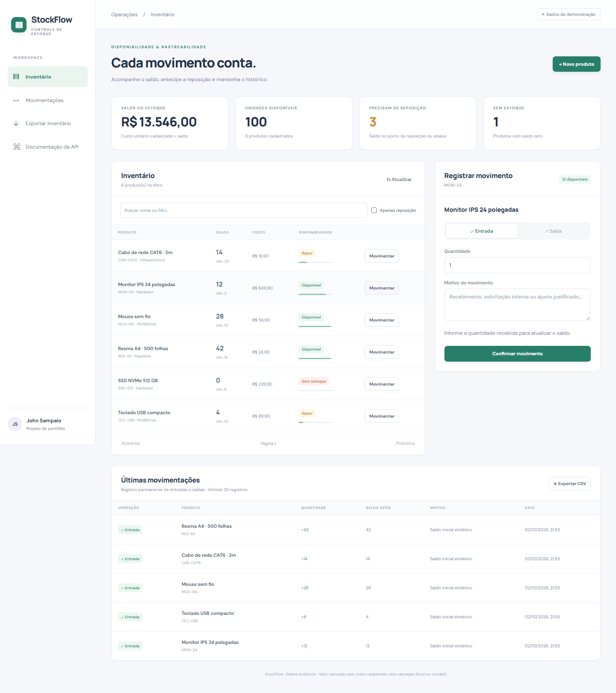
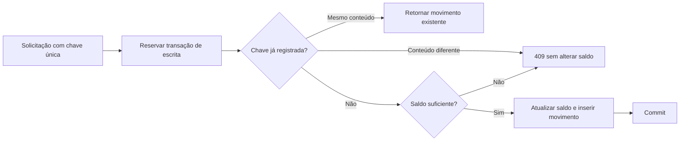

# StockFlow · Inventário e movimentações

[](https://github.com/JVCSampaio/stockflow/actions/workflows/ci.yml) · [Portfólio](https://github.com/JVCSampaio)

Controle de estoque com **React + TypeScript**, **API REST em Python/FastAPI** e **SQLite**.
Entradas e saídas atualizam o saldo e o histórico na mesma transação. Reenvios da mesma operação não movimentam o estoque duas vezes.



## Problema e entrega

Em um almoxarifado fictício de materiais de TI, registros avulsos podem gerar saldo negativo,
duplicação de recebimentos e falta de informação sobre reposição. O projeto trata esses cenários explicitamente.
Os produtos e movimentos iniciais são sintéticos; o sistema é um projeto de portfólio, sem clientes reais.

- Cadastro de produtos com SKU único, categoria, custo em centavos e ponto de reposição.
- Busca, paginação e filtro de itens que precisam de reposição.
- Movimentações justificadas e histórico com saldo após cada operação.
- Saídas acima do saldo recusadas sem gravar um movimento parcial.
- Chave de idempotência para reenviar a mesma solicitação após uma falha de rede.
- Indicadores de saldo, reposição e valor pelo custo cadastrado.
- CSV de produtos e movimentos para Excel/Power BI, com proteção contra fórmulas.

## Executar

Requisitos: **Python 3.14** e **Node.js 24**. Dependências fixadas em requirements e package-lock.

```bash
python -m venv .venv
```

Ative o ambiente: `.venv\Scripts\Activate.ps1` no PowerShell ou `source .venv/bin/activate` no Linux/macOS.

```bash
pip install -r requirements-dev.txt
cd web
npm ci
npm run build
cd ..
python -m uvicorn app.main:app --host 127.0.0.1 --port 8012
```

Abra **http://127.0.0.1:8012**. A API serve o build React na mesma origem.
Swagger: **http://127.0.0.1:8012/docs**. O banco fica em `.data/stockflow.db`.
O primeiro início carrega seis produtos de demonstração e seus movimentos de abertura.
Reiniciar preserva os dados; `APP_DB` permite escolher outro arquivo SQLite.

Para desenvolvimento, mantenha a API ativa e rode `npm run dev` em `web/`.
O Vite encaminha `/api` para a porta 8012.

### Docker

```bash
docker compose up --build
```

O serviço usa a porta 8012, com volume persistente e publicação limitada ao endereço local.
A imagem tem build React em etapa Node e executa a API como usuário sem privilégios administrativos.

## Regra principal



Quantidades são inteiras positivas. A API trabalha com dinheiro em centavos, evitando usar números
de ponto flutuante para armazenar valores. Produtos novos começam com saldo zero; uma entrada registra a abertura.
Um produto precisa de reposição quando `quantity <= reorder_point`.

## API

| Método e rota | Comportamento |
|---|---|
| `GET /api/products` | Busca literal, filtro `low_stock` e paginação. |
| `POST /api/products` | Cria produto com SKU normalizado e saldo zero. |
| `GET /api/products/{id}` | Consulta saldo e dados cadastrais. |
| `POST /api/movements` | Entrada/saída com `idempotency_key` UUID v4 obrigatória. |
| `GET /api/movements` | Histórico, filtro por produto e paginação. |
| `GET /api/metrics` | Unidades, valor, itens em reposição e sem estoque. |
| `GET /api/export/products.csv` | Snapshot do inventário. |
| `GET /api/export/movements.csv` | Movimentos com referência ao produto. |

Um novo movimento retorna `201`; um replay idêntico retorna `200` com `Idempotent-Replayed: true`.
SKU duplicado, saldo insuficiente ou reutilização da chave com outro conteúdo retornam `409`.
Entrada inválida retorna `422`. Veja [docs/ANALISE.md](docs/ANALISE.md) para contratos e decisões.

## Verificar

Com o ambiente Python ativado:

```bash
ruff check app tests
ruff format --check app tests
pytest -q
cd web
npm ci
npm run lint
npm run build
npx playwright install chromium
npm run test:e2e
```

Os testes de API incluem duas saídas concorrentes para o mesmo saldo, duas entradas concorrentes com
a mesma chave, rollback, reconciliação saldo/histórico, SKU, filtros, CSV e persistência após reinício.
Playwright exercita cadastro, entrada, saída recusada, saída válida, reload e viewport de 390 px.
O banco dos testes de interface é `.data/e2e.db`. O CI também constrói e verifica o container.

## Power BI e documentação

[docs/POWER_BI.md](docs/POWER_BI.md) descreve a importação dos CSVs, o relacionamento entre tabelas
e medidas DAX sugeridas. Os CSVs de exemplo são produzidos pela API, não montados manualmente.
A exportação não equivale a um relatório publicado; as medidas são material de integração, sem validação no Desktop nesta sessão.

## Estrutura e limites

`app/service.py` concentra a transação; `app/db.py`, schema e conexões; `app/main.py`, validação HTTP;
`web/src/`, interface; `tests/` e `web/e2e/`, verificações; `docs/`, análise, casos de teste e exemplos de BI.

O escopo é um almoxarifado local com unidades inteiras. Não há autenticação, múltiplos depósitos,
reserva de saldo, lote, validade, edição de custo, integração fiscal ou método de valoração contábil.
O indicador financeiro usa o custo cadastrado, sem FIFO ou custo médio.
A chave de reenvio permanece na memória do formulário após falha; recarregar a página encerra essa tentativa.
SQLite usa um único escritor por vez; os testes verificam conflitos específicos, sem afirmar capacidade de produção.

Referências: [FastAPI — bancos SQL](https://fastapi.tiangolo.com/tutorial/sql-databases/),
[React — formulários e eventos](https://react.dev/learn/responding-to-events).

Licença [MIT](LICENSE).
