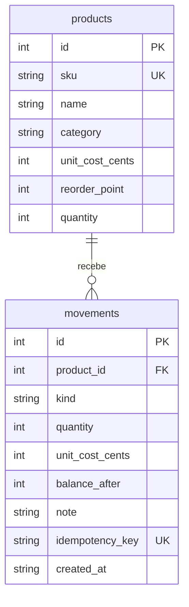

# Análise funcional e decisões

## Demanda

Persona fictícia: operador de almoxarifado que recebe materiais e atende solicitações internas.
Objetivo: conhecer o saldo disponível e justificar cada mudança sem duplicar uma operação após falha de rede.

| ID | Requisito | Critério de aceite | Evidência |
|---|---|---|---|
| RF01 | Cadastrar produto | SKU normalizado e único; saldo inicial zero. | `test_create_normalizes_sku_and_rejects_duplicate` |
| RF02 | Registrar movimento | Quantidade inteira positiva e justificativa; saldo e evento juntos. | `test_entry_exit_metrics_and_ledger`, E2E de movimentação |
| RF03 | Impedir saldo negativo | Saída maior que saldo retorna 409 sem registro parcial. | `test_insufficient_stock_rolls_back_everything` |
| RF04 | Repetir com segurança | Mesma chave e conteúdo não movimentam novamente; outro conteúdo retorna 409. | `test_retry_is_idempotent_and_conflicting_payload_is_rejected` |
| RF05 | Tratar concorrência | Duas saídas não vendem mais que o saldo; duas entradas com mesma chave criam um evento. | `test_simultaneous_exits_cannot_oversell`, `test_simultaneous_retry_records_only_one_entry` |
| RF06 | Reposição e consulta | Itens no ponto mínimo entram no filtro; busca literal e paginação funcionam. | `test_filters_and_literal_search` |
| RF07 | Exportação | CSV preserva chaves e trata nomes/motivos como texto. | `test_csv_exports_and_formula_protection` |
| RNF01 | Persistência | Reinício conserva saldo, carga inicial e soma dos movimentos. | `test_restart_and_seed_ledger_reconcile` |

## Modelo



Schema em `app/db.py`, com chaves estrangeiras, quantidade não negativa e chave de operação única.
O versionamento inicial usa `PRAGMA user_version=1`; versões desconhecidas interrompem o início.
Não há migrador incremental nesta entrega.

## Decisões

- `BEGIN IMMEDIATE` reserva a escrita antes de verificar chave e saldo; o SQLite serializa esses escritores.
- `service.py` contém a regra de movimentação; a camada HTTP valida contrato e traduz os erros.
- Centavos e unidades inteiras mantêm os cálculos de saldo e valor determinísticos.
- O movimento guarda custo e saldo após a operação. Produtos não têm exclusão ou ajuste direto de quantidade.
- O saldo é materializado para leitura simples; testes reconciliam a quantidade com entradas menos saídas.
- Não existe um endpoint para apagar histórico. Correções operacionais precisam de um novo movimento justificado.
- Reenvio exige a mesma chave UUID v4. O React preserva chave e conteúdo após falha; uma alteração nos campos inicia outra operação.
- Se a página for recarregada após resposta incerta, consulte o histórico antes de gerar uma nova operação.

## Exemplo de contrato

```json
{
  "product_id": 1,
  "kind": "out",
  "quantity": 2,
  "note": "Solicitação interna de materiais",
  "idempotency_key": "8a9ba861-e5af-4f21-a394-d1f23b0e6f72"
}
```

`POST /api/movements` retorna `201`, o ID, o saldo após a saída e o custo em centavos.
Repetir exatamente o contrato retorna o mesmo movimento com `200`. Reutilizar a chave com quantidade 3 retorna `409`.

## Cenários de teste manual

1. Cadastrar produto; verificar saldo zero e item em reposição.
2. Registrar entrada de 10 unidades e confirmar o histórico.
3. Tentar saída de 11: conferir erro, saldo 10 e ausência de evento.
4. Registrar saída de 7: conferir saldo 3 e alerta conforme ponto de reposição.
5. Reenviar o mesmo contrato pela API: conferir ID repetido e saldo inalterado.
6. Exportar produtos e movimentos; comparar saldo com soma assinada dos movimentos.

## Registro de defeito

**BUG-001 — tabela ultrapassava a largura da página no celular.**
O fluxo de 390 px reprovou o teste de `scrollWidth`. A investigação mediu uma página de 404 px
e identificou o rótulo acessível da coluna de ações, posicionado fora da área rolável.
A correção definiu `min-width: 0` no painel e `position: relative` na área rolável da tabela,
mantendo o rótulo dentro desse contexto. O mesmo teste foi executado novamente após a correção.

O TestClient da versão atual de Starlette emite aviso de depreciação para httpx; os testes de API continuam passando.
Consulte `VERIFICACAO.md` para resultados finais e limites.
